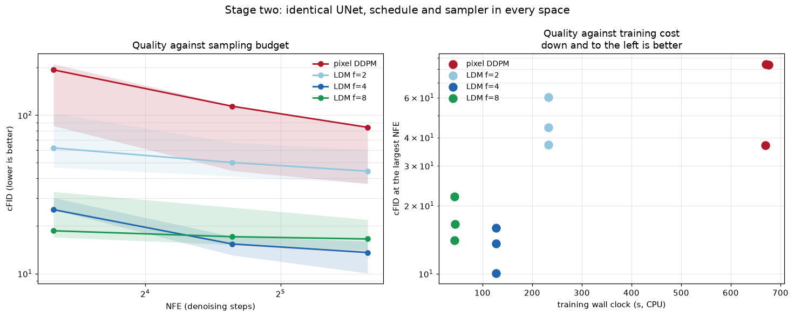
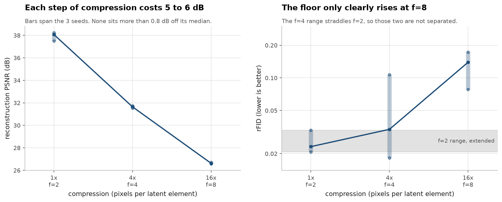
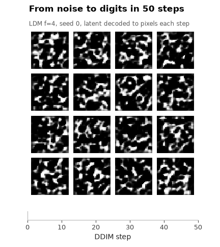
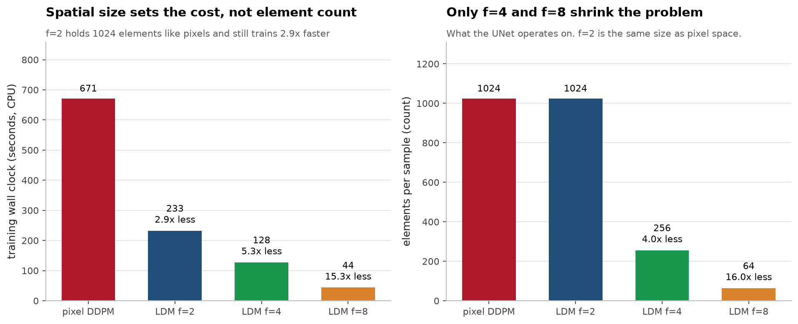

# latent-diffusion-from-scratch

[](https://github.com/aghasalim/latent-diffusion-from-scratch/actions/workflows/ci.yml)
[](https://www.python.org/)
[](LICENSE)
[](results/)
[](https://doi.org/10.5281/zenodo.23003654)

I wanted to check the main idea of the LDM paper myself, so I built a
KL-regularised autoencoder and a DDPM and compared diffusion in a compressed
latent against diffusion in pixels. Everything runs on MNIST at 32x32 on my
laptop CPU, with three seeds, and takes about 100 minutes end to end.

With the same number of training steps, diffusion in a 4x compressed latent
trained 5.3x faster than the pixel baseline. Its samples also came out 6.2x better.
At 16x compression it was 15.3x faster and still 5.1x better.



## The claim being tested

In pixel space a diffusion model spends a lot of its capacity on texture. The
LDM paper splits the job in two. An autoencoder does the perceptual compression,
and the diffusion model only has to handle composition in the smaller space. I
kept the diffusion side identical in every run. It's the same UNet, cosine
schedule, DDIM sampler and step count each time, so the only thing that changes
is where the diffusion happens.

The setting I vary is the downsampling factor f. If I compress too little, stage
two stays expensive. If I compress too much, the decoder loses detail that no
diffusion model on top can get back. I wanted to find out where that tradeoff
lands.

## Stage one: what the autoencoder costs

Median of 3 seeds. I added the seed range for rFID because it's much noisier
than the reconstruction error next to it.

| f | latent | compression | recon PSNR | rFID | rFID range over seeds | AE train |
|---:|---|---:|---:|---:|---|---:|
| 2 | (4, 16, 16) | 1.0x | 38.08 dB | 0.023 | 0.021 to 0.033 | 193 s |
| 4 | (4, 8, 8) | 4.0x | 31.65 dB | 0.034 | 0.018 to 0.107 | 245 s |
| 8 | (4, 4, 4) | 16.0x | 26.63 dB | 0.139 | 0.078 to 0.172 | 299 s |



rFID measures reconstruction quality in the same feature space I use for
generation. It acts as a floor, since a model trained on top of this autoencoder
can't make samples better than the autoencoder's own reconstructions.

Because of the range column I only make one claim in this section. Across seeds,
PSNR spans 0.73 dB at f=2. At f=4 it spans 0.20 dB, and at f=8 it spans 0.14 dB.
The f=2 spread is the widest of the three. Even at their closest seeds the levels
are 5.8 dB and 4.8 dB apart, so I trust the distortion ordering. I don't trust
the rFID ordering in the same way. At f=4 the three seeds go from 0.018 to 0.107,
a factor of 5.9, and that interval covers all of f=2's. So rFID doesn't separate
f=2 from f=4, and I shouldn't read the medians 0.023 and 0.034 as a rise.

f=8 looks different. Its range, 0.078 to 0.172, doesn't overlap f=2's at all.
The floor really does go up there, and that's where compression starts to cost
something. All the numbers behind this are in the table.

f=2 ended up being a handy control. It has four latent channels at half
resolution, which works out to 1.0x compression, so the latent isn't actually
any smaller. It still beats pixel diffusion on the median at every step budget.
My guess is that part of the gain comes from the latent being a smoother, more
Gaussian space to diffuse in, and part from having fewer elements. The seeds do
overlap, though. At 50 NFE the best pixel run is better than all three f=2 runs,
which makes f=2 against pixel the weakest comparison in stage two. f=4 and f=8
don't overlap pixel at any budget.

## Stage two: quality against cost

Median of 3 seeds. Identical UNet, schedule and sampler throughout.

| model | elements per sample | train | cFID@10 | cFID@25 | cFID@50 | sW2@50 |
|---|---:|---:|---:|---:|---:|---:|
| pixel DDPM | 1024 | 671 s | 192.90 | 113.67 | 83.71 | 0.1759 |
| LDM f=2 | 1024 | 233 s | 62.06 | 50.21 | 44.29 | 0.1102 |
| **LDM f=4** | 256 | 128 s | 25.31 | 15.38 | **13.59** | **0.0802** |
| LDM f=8 | 64 | 44 s | 18.63 | 17.09 | 16.54 | 0.1008 |



This animation shows the f=4 row of that table being made. It's 16 samples from
seed 0 with DDIM at 50 steps, and I decode the latent to pixels after every step.
The model, schedule and starting noise stay fixed while the step index moves. A
few of the sixteen never turn into a digit, which gives a feel for what a cFID of
13.59 looks like up close.



I put the rest of the cost accounting in
[notes/METHODS.md](notes/METHODS.md#stage-two-quality-against-cost).

## Metrics, named honestly

Standard FID uses InceptionV3 features trained on ImageNet. Those don't suit
32x32 grayscale digits, so a number computed with them wouldn't mean what the
name suggests. I named my metrics after what they actually measure instead. The
reasoning and the features I used are in
[notes/METHODS.md](notes/METHODS.md#metrics-named-honestly).

## What I got wrong

My UNet skip connections were misaligned and the shapes didn't give it away.
In the first version I rebuilt the skip channel counts from the multiplier list
when I should have saved them on the way down. I wrote up the whole debugging
trail, including how long it took me to look in the right place, in
[notes/METHODS.md](notes/METHODS.md#what-i-got-wrong).

## Limitations

- Stage one has no perceptual or adversarial loss. The paper uses both. Without
  them my reconstructions get blurry at high f, which LPIPS would punish more
  than MSE does.
- MNIST at 32x32 is far from 256x256 faces. I'd expect the mechanism to carry
  over, but not the numbers.
- 1200 diffusion steps is short, and the pixel baseline is especially undertrained.
- I didn't add conditioning, classifier-free guidance or cross attention, so this
  is unconditional generation only.

## Running it

```bash
python -m venv .venv && source .venv/bin/activate
pip install -r requirements.txt
```

```bash
python -m pytest tests/ -q
```

```bash
python -m experiments.main --seeds 0 1 2 --fs 2 4 8 --n 15000 --ae-steps 1000 --dm-steps 1200 --eval-n 750
```

```bash
python -m bench.figures
```

The sweep takes about 100 minutes on an M4 CPU and writes `results/stage1.csv`
and `results/stage2.csv`. I traced the settings it ran with line by line to the
code and data in [notes/SWEEP.md](notes/SWEEP.md). The plots only read those files and never re-run an
experiment, so a plot can't disagree with a number in this README. I also rebuild
every published number from the seed-level CSVs with the reimplementations under
`verify/`. If one of them gets a different answer, CI blocks the merge.

The animation works differently, because a sampling trajectory isn't in a table.
It retrains the f=4 pair at seed 0 with the settings saved in
`results/run-meta.json`, which takes about six minutes, and caches the frames
next to the figures. It doesn't write a CSV.

MNIST gets downloaded to `data/` the first time you run it.

## Layout

```
ldm/data.py         MNIST padded to 32x32 so f=2,4,8 all divide evenly
ldm/autoencoder.py  KL-regularised autoencoder, the compression knob
ldm/unet.py         epsilon predictor, identical in both spaces
ldm/diffusion.py    cosine schedule, DDPM training, DDIM sampling
ldm/metrics.py      cFID and sliced W2, both named for what they are
experiments/main.py the sweep
tests/              33 tests
verify/             the published tables, rebuilt in other languages
```

## Sources

- **Rombach, Blattmann, Lorenz, Esser, Ommer. High-Resolution Image Synthesis with Latent Diffusion Models. CVPR 2022.** [arXiv:2112.10752](https://arxiv.org/abs/2112.10752) The factorisation this repo tests, and the f ablation in section 4.1.
- **Ho, Jain, Abbeel. Denoising Diffusion Probabilistic Models. NeurIPS 2020.** [arXiv:2006.11239](https://arxiv.org/abs/2006.11239) The training objective.
- **Song, Meng, Ermon. Denoising Diffusion Implicit Models. ICLR 2021.** [arXiv:2010.02502](https://arxiv.org/abs/2010.02502) DDIM, which is what makes a small NFE budget meaningful.
- **Nichol, Dhariwal. Improved Denoising Diffusion Probabilistic Models. ICML 2021.** [arXiv:2102.09672](https://arxiv.org/abs/2102.09672) The cosine schedule used here.
- **Esser, Rombach, Ommer. Taming Transformers for High-Resolution Image Synthesis. CVPR 2021.** [arXiv:2012.09841](https://arxiv.org/abs/2012.09841) The first-stage autoencoder design, including why the KL weight is tiny.
- **Heusel, Ramsauer, Unterthiner, Nessler, Hochreiter. GANs Trained by a Two Time-Scale Update Rule Converge to a Local Nash Equilibrium. NeurIPS 2017.** [arXiv:1706.08500](https://arxiv.org/abs/1706.08500) The FID formula, applied here to different features and renamed accordingly.
- MNIST from the CVDF mirror of LeCun's dataset.

I tried the same generative problem with a straight interpolant instead of the
diffusion path in
[rectified-flow-from-scratch](https://github.com/aghasalim/rectified-flow-from-scratch).

## Methodology

[`METHODOLOGY.md`](METHODOLOGY.md) has the rules I follow in this repo. Rule 6
says every number has to come from a measurement, and rule 13 says I have to
list what I didn't measure. Those two are why the limitations section is as long
as it is.

## License

MIT, see [LICENSE](LICENSE).
